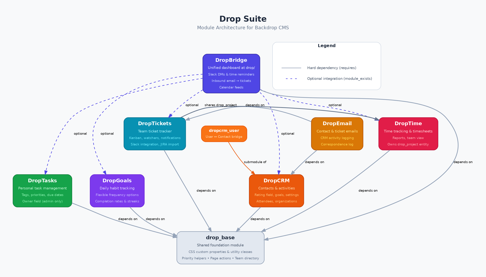

# Drop Suite

A modular productivity and CRM platform for [Backdrop CMS](https://backdropcms.org).

Drop Suite is a collection of loosely-coupled Backdrop modules for managing
contacts, projects, tickets, time, tasks, goals, documentation, and team
communication. Each module can be enabled independently (respecting
dependencies), so you can start with just what you need and add capabilities
over time.

## Modules

| Module | Description | Path | Dependencies |
|--------|-------------|------|--------------|
| [drop_suite](drop_suite/) | Shared CSS, helpers, nav bar, team directory | — | *none* |
| [DropBridge](dropbridge/) | Unified daily dashboard, Slack DMs, inbound email | `drop/` | drop_suite |
| [Drop CRM](drop_crm/) | Contacts, activities, projects, contact methods | `drop/crm` | drop_suite, entity_plus, entity_ui, entityreference |
| [DropDocs](dropdocs/) | Hierarchical team wiki / documentation | `drop/docs` | drop_suite |
| [DropEmail](dropemail/) | Outbound email from contacts & tickets, activity logging | — | drop_crm |
| [DropGoals](dropgoals/) | Daily habit / goal tracking with flexible frequency | `drop/goals` | drop_suite |
| [DropNewsletter](dropnewsletter/) | Newsletter subscriptions on CRM contacts | — | drop_crm, simplenews |
| [DropStrategic](dropstrategic/) | OKR-style strategic goal tracking | `drop/strategic` | drop_suite, entity_plus |
| [DropTasks](droptasks/) | Personal task management with tags and priorities | `drop/tasks` | drop_suite |
| [DropTickets](droptickets/) | Team ticket tracker with kanban, watchers, Slack | `drop/tickets` | drop_suite, drop_crm, entity_plus |
| [DropTime](droptime/) | Project time tracking, timesheets, reports | `drop/time` | drop_suite, drop_crm |

### Architecture at a glance

- **drop_suite** is the foundation. Every other Drop module depends on it (directly or transitively). It provides shared CSS custom properties, priority helpers, the Drop navigation bar, and the team directory.
- **Drop CRM** is the core data module. It defines contacts, activities, contact methods, and the `drop_project` entity used by DropTickets and DropTime.
- **DropBridge** is the integration hub. It pulls from Drop CRM, DropTasks, DropGoals, DropTickets, and DropTime via `module_exists()` checks — all are optional.
- **DropEmail**, **DropNewsletter**, and **DropTime** extend Drop CRM with email, newsletter, and time tracking capabilities.
- **DropTasks**, **DropGoals**, **DropDocs**, and **DropStrategic** are standalone modules that depend only on drop_suite (and entity_plus where needed).

## Requirements

- Backdrop CMS 1.x
- [Entity Plus](https://github.com/backdrop-contrib/entity_plus) (for Drop CRM, DropTickets, DropStrategic)
- [Entity UI](https://github.com/backdrop-contrib/entity_ui) (for Drop CRM)
- [Entity Reference](https://github.com/backdrop-contrib/entityreference) (for Drop CRM)
- [SimpleNews](https://github.com/backdrop-contrib/simplenews) (only for DropNewsletter)

## Installation

1. Place the entire `drop/` directory in your site's `modules/` folder (e.g. `modules/drop/`).
2. Enable **drop_suite** first, then enable whichever modules you need. Backdrop will resolve dependencies automatically.
3. Place the **Drop Nav** block in your layout to get the shared navigation bar across all Drop pages.
4. Grant permissions under **Administration > Configuration > People > Permissions**. Key roles:
   - `team_member` — basic access to tickets, tasks, time, and the team directory
   - `project_manager` — administrative access to tickets (flag, close, delete)

## Quick start

For a minimal CRM setup:
- Enable: `drop_suite`, `drop_crm`

For a full team productivity suite:
- Enable: `drop_suite`, `drop_crm`, `droptickets`, `droptime`, `droptasks`, `dropgoals`, `dropbridge`

For documentation and strategic planning:
- Add: `dropdocs`, `dropstrategic`

## Permissions overview

Each module defines its own permissions. Common patterns:

- `access <module>` — view and use basic features
- `administer <module>` — full administrative access
- Module-specific permissions (e.g. `flag droptickets`, `choose billable status`)

## Configuration

Most modules store configuration in Backdrop's config system (JSON files in `config/`). Settings pages are available at:

- **Drop CRM**: `drop/crm/settings`
- **DropTickets**: `drop/tickets/settings`
- **DropBridge**: `drop/settings` (Slack, inbound email)
- **DropEmail**: `drop/admin/dropemail`

## License

This project is GPL v2 compatible, as required by Backdrop CMS.
